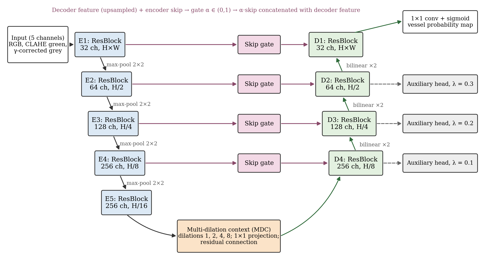

# DCG-Net: Deep Context-Gated Network for Retinal Vessel Segmentation

DCG-Net is a compact encoder–decoder network (5.90 M parameters) for segmenting blood vessels in colour fundus images. This repository contains the PyTorch implementation, the training and evaluation scripts used for the reported results, and the trained weights for DRIVE and CHASE_DB1.



## Method

- **Input.** Five channels: RGB, CLAHE-enhanced green channel and gamma-corrected CLAHE grey image, scaled to [−1, 1].
- **Encoder.** Five residual levels (32, 64, 128, 256, 256 channels) that reduce the resolution to 1/16 of the input.
- **Multi-dilation context (MDC) module.** Parallel 3 × 3 convolutions with dilation rates 1, 2, 4 and 8 at the bottleneck, followed by a 1 × 1 projection and a residual connection.
- **Gated skip connections.** For each skip connection a spatial gate α = σ(W_b ∗ ReLU(W_a ∗ [D↑, S])) is computed from the upsampled decoder feature and the encoder feature, and α ⊙ S is passed to the decoder.
- **Deep supervision.** Auxiliary heads at 1/2, 1/4 and 1/8 resolution, used during training only.
- **Loss.** L = L_reg(P, Y) + λ_cl(t) L_clDice + Σ_k λ_k L_reg(P_k, Y), where L_reg = BCE + 0.5 soft Dice restricted to the field of view (FOV), λ_cl(t) = 0.2 · min(1, t / 0.2T) and λ_1..3 = 0.3, 0.2, 0.1.
- **Training.** 384 × 384 patches centred on thin-vessel pixels (p = 0.35), any vessel pixel (0.30) or any FOV pixel (0.35); label-preserving augmentation (90° rotations, flips, intensity jitter); AdamW with a one-cycle schedule, 6000 iterations, batch 4, mixed precision; exponential moving average of the weights.
- **Model selection.** Four training images of each dataset are held out; the checkpoint and threshold with the best validation F1 are kept. Test images are used once, for the final evaluation.
- **Inference.** Four flip views are averaged; three models (seeds 1–3) form the ensemble.

## Results

Metrics are pooled over FOV pixels of all test images (%). "Thin Se" is the sensitivity for vessels with a local radius of at most two pixels.

| Dataset | Model | Se | Sp | Acc | AUC | F1 | Thin Se |
|---|---|---|---|---|---|---|---|
| DRIVE | single model (mean ± SD, 3 seeds) | 82.70 ± 0.57 | 97.54 ± 0.10 | 95.65 ± 0.02 | 97.95 ± 0.02 | 82.87 ± 0.04 | 75.61 |
| DRIVE | 3-model ensemble | 83.72 | 97.37 | 95.63 | 98.02 | 82.98 | 76.96 |
| CHASE_DB1 | single model (mean ± SD, 3 seeds) | 83.06 ± 0.46 | 98.06 ± 0.07 | 96.68 ± 0.02 | 98.66 ± 0.00 | 82.12 ± 0.05 | 55.53 |
| CHASE_DB1 | 3-model ensemble | 82.40 | 98.17 | 96.72 | 98.70 | 82.17 | 54.07 |
| STARE (4-fold CV) | single model (mean ± SD, 3 seeds) | 82.38 ± 0.27 | 98.58 ± 0.03 | 97.05 ± 0.01 | 98.79 ± 0.06 | 84.06 ± 0.06 | 75.12 |
| STARE (4-fold CV) | 3-model ensemble | 83.05 | 98.53 | 97.07 | 98.89 | 84.25 | 76.18 |

Splits: DRIVE 20 training / 20 test images (validation 22, 27, 34, 39); CHASE_DB1 images 01L–10R for training and 11L–14R for testing (validation 09L, 09R, 10L, 10R); STARE four-fold cross-validation over the 20 images sorted by name, 12 training and 3 validation images per fold, first-observer (A. Hoover) labels. FOV masks for CHASE_DB1 and STARE are derived from the image (red channel > 15, 5 × 5 opening, hole filling, largest component, two 3 × 3 erosions).

Training one model takes about 19 minutes on an NVIDIA Tesla T4; inference with four-view augmentation takes 0.40 s per DRIVE image and 1.16 s per CHASE_DB1 image on the same GPU.

## Installation

```bash
git clone https://github.com/vanithamagesh/DCG-Net.git
cd DCG-Net
pip install -r requirements.txt
```

## Data

```bash
bash scripts/get_data.sh
```

This places DRIVE and CHASE_DB1 in `data/sgl/dataset` (folders `DRIVE`, `DRIVET`, `CHASE`, `CHASET`, each with `HR/`, `VE/` and, for DRIVE, `mask/`) and STARE in `data/stare`. The licence and access conditions of each dataset apply.

## Pretrained weights

The weights are attached to the [v1.0.0 release](https://github.com/vanithamagesh/DCG-Net/releases/tag/v1.0.0):

```bash
mkdir -p weights
for d in drive chase; do for s in 1 2 3; do
  wget -q -P weights https://github.com/vanithamagesh/DCG-Net/releases/download/v1.0.0/dcgnet_${d}_seed${s}.pt
done; done
```

Each file stores the model weights, the training configuration and the validation-selected threshold. SHA-256 checksums are listed in `weights/SHA256SUMS.txt`.

## Usage

Reproduce the test results from the released weights:

```bash
python scripts/evaluate.py --data data/sgl/dataset --dataset DRIVE --weights weights/dcgnet_drive_seed*.pt
python scripts/evaluate.py --data data/sgl/dataset --dataset CHASE --weights weights/dcgnet_chase_seed*.pt
```

Train three models and the ensemble from scratch (a CUDA GPU is required for reasonable run times):

```bash
python scripts/train_eval.py --data data/sgl/dataset --dataset DRIVE --out runs
python scripts/train_eval.py --data data/sgl/dataset --dataset CHASE --out runs
python scripts/cv_stare.py  --stare data/stare --out runs_stare
```

Segment your own fundus images:

```bash
python scripts/predict.py --weights weights/dcgnet_drive_seed*.pt --images my_images/ --out predictions/
```

In Python:

```python
import dcgnet as D
model, threshold = D.load_checkpoint("weights/dcgnet_drive_seed1.pt", "cuda")
cases = D.load_dataset("data/sgl/dataset", "DRIVE", "test")
prob = D.predict(model, cases[0], "cuda")          # probability map, 4-view TTA
mask = prob >= threshold
```

A Colab notebook that runs these steps on a free T4 GPU is provided in `notebooks/DCGNet_Colab.ipynb`.

## Repository layout

```
dcgnet/model.py      DCG-Net architecture (residual encoder, MDC module, gated skips, deep supervision)
dcgnet/losses.py     FOV-restricted BCE + Dice, soft clDice, deep-supervision weighting
dcgnet/data.py       input channels, FOV masks, thin-vessel masks, DRIVE/CHASE_DB1/STARE loaders, patch sampler
dcgnet/engine.py     training loop with EMA and validation selection, TTA inference, pooled metrics
scripts/             train_eval.py, cv_stare.py, evaluate.py, predict.py, get_data.sh
```

## Citation

Citation details will be added when the accompanying paper is published.

## Licence

The code is released under the MIT Licence. The datasets are subject to the terms of their providers.
